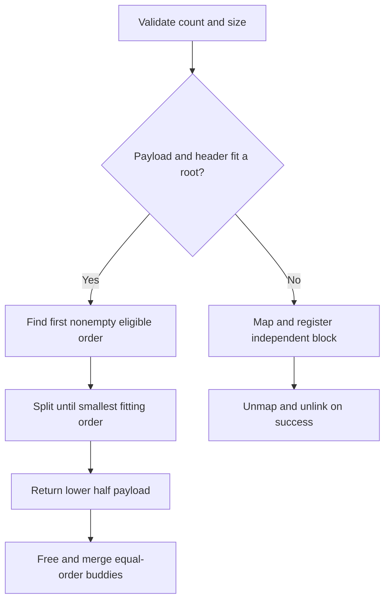

# Allocation and ownership

## Metadata and invariants

Stage three first obtains 32 roots of 131,072 bytes. The arena begins on a 4 MiB boundary. Alignment padding and the arena are acquired in one positive sbrk call after querying the break. The allocator never shrinks the break. A request can therefore fail for lack of a suitable arena block even if a smaller block is still free. A header immediately precedes every payload and contains the total block size, a free flag and two list links. On the tested AArch64 ABI the stage-three header is 32 bytes. The payload inherits max_align_t alignment. Stage one and two deliberately offer byte granularity; clients must account for alignment when storing typed objects.

Order k has total size 128 shifted left by k. Each free list contains only free blocks of its order and is sorted by address. Searching at most 11 list heads finds the smallest available order; sorted insertion can take linear time in the list length. Splitting adds one header and one block. Coalescing removes one header, returning its bytes to usable capacity. A fixed 4 KiB bitmap records live allocation starts at 128-byte granularity outside the arena.

The buddy's offset is the current block's offset XOR its total block size. Only equal-sized free buddies can merge, and a merge never crosses a root. Two adjacent free ranges need not be buddies. A request of 131,040 bytes fits the tested root exactly; 131,041 needs a mapping because of its header. Payload sizes above 100,000,000 bytes, zero sizes and overflowing calloc products fail.

## Reallocation

A sufficiently large arena block is reused. Growth first simulates the entire chain of available buddies without modifying the lists. If sufficient, the actual merges commit. A lower-address buddy changes the returned pointer; memmove preserves the old payload prefix. Otherwise, a successful fresh allocation is populated before releasing the old block. A mapped block is retained only for unchanged size; a changed size follows allocate/copy/free. A failed realloc, including a zero-size request, leaves the original allocation live.

Free consults the live bitmap or mapping list before trusting header data. Mapping links and accounting are committed only after a successful munmap. Releasing the same address again before reuse is harmless. Once the address has been reused, a raw pointer cannot distinguish its previous owner. The caller remains responsible for ownership, bounds and thread exclusion.

## Reading the counters

Allocated blocks include both live and free chunks. Allocated bytes are total managed bytes minus all current headers. Free bytes are usable capacities of free arena chunks. Mapped bytes are counted at requested mapping length, excluding kernel page rounding. Counters exclude alignment padding, static tables and the live bitmap. Internal fragmentation is unused capacity inside live chunks. External fragmentation is visible when aggregate free capacity is sufficient but no eligible contiguous block exists.
